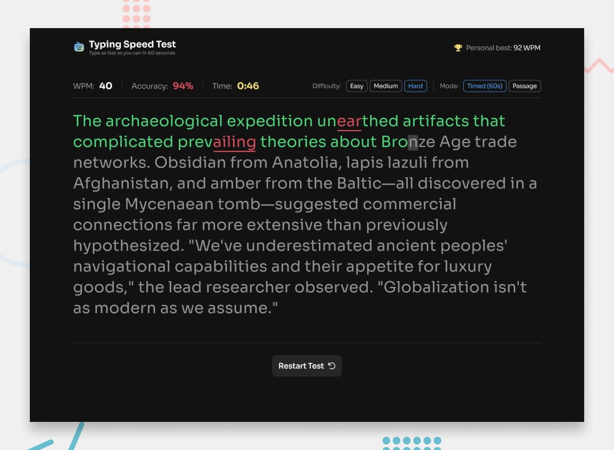

# Frontend Mentor - Typing Speed Test

A responsive typing speed test built as a solution to
the [Frontend Mentor Typing Speed Test challenge](https://www.frontendmentor.io/challenges/typing-speed-test). The app
lets users practice typing with passages of different difficulty levels, track their performance, and try to beat their
personal best.

## Table of contents

- [Overview](#overview)
  - [Features](#features)
  - [Preview](#preview)
  - [Links](#links)
- [Getting started](#getting-started)
- [My process](#my-process)
  - [Built with](#built-with)
  - [What I learned](#what-i-learned)
  - [Continued development](#continued-development)
  - [Useful resources](#useful-resources)
  - [AI collaboration](#ai-collaboration)
- [Author](#author)
- [Acknowledgments](#acknowledgments)

## Overview

### Features

- **Two test modes:** a 60-second timed test and a passage mode with no time limit.
- **Three difficulty levels:** Easy, Medium, and Hard, each with its own collection of passages.
- **Random passages:** a new passage is selected when a test starts or restarts.
- **Live statistics:** words per minute (WPM), typing accuracy, and elapsed or remaining time are updated while typing.
- **Typing feedback:** correctly typed characters, mistakes, and the current cursor position are visually distinguished.
- **Mistake tracking:** Backspace can be used to correct input; previously made mistakes still count towards the error
  total.
- **Results summary:** completed tests display WPM, accuracy, and correct and incorrect character counts.
- **Personal best:** the highest WPM score is saved in `localStorage` and restored on later visits.
- **Achievement feedback:** the app displays different result messages for a first test, a regular result, and a new
  personal best. A confetti animation celebrates a new record.
- **Responsive interface:** the layout adapts to different screen sizes, with appropriate controls for smaller screens.

### Preview

The repository includes the original Frontend Mentor design preview (`preview.jpg`). It is provided as a reference for
the challenge, not as a screenshot of the completed implementation.



### Links

- **Frontend Mentor challenge:** [Typing Speed Test](https://www.frontendmentor.io/challenges/typing-speed-test)
- **GitHub repository:** [runny-life/typing-speed-test](https://github.com/runny-life/typing-speed-test)
- **Live site:** [GitHub Pages](https://runny-life.github.io/typing-speed-test/).

## Getting started

To run the project locally, you need [Node.js](https://nodejs.org/) and npm installed.

1. Clone the repository:

   ```bash
   git clone https://github.com/runny-life/typing-speed-test.git
   ```

2. Navigate to the project directory:

   ```bash
   cd typing-speed-test
   ```

3. Install the dependencies:

   ```bash
   npm install
   ```

4. Start the development server:

   ```bash
   npm run dev
   ```

5. Open the local URL printed in your terminal by Vite.

### Available scripts

| Command             | Description                                         |
| ------------------- | --------------------------------------------------- |
| `npm run dev`       | Starts the Vite development server.                 |
| `npm run build`     | Creates a production build in the `dist` directory. |
| `npm run preview`   | Serves the production build locally for preview.    |
| `npm run formatter` | Formats project files with Prettier.                |
| `npm run deploy`    | Deploys the contents of `dist` using `gh-pages`.    |

## My process

### Built with

- Semantic HTML5
- SCSS (Sass)
- Vanilla JavaScript (ES modules)
- Vite
- CSS Flexbox and Grid
- Responsive, mobile-first styling
- Browser `localStorage` for persistent personal-best data
- Canvas API and `requestAnimationFrame` for the confetti animation
- Prettier for code formatting

### What I learned

This project gave me practice with managing an interactive application using vanilla JavaScript and separating its
responsibilities into small modules.

Some of the main concepts I worked with were:

- **DOM manipulation:** creating a separate element for each character in a passage and updating its visual state as the
  user types.
- **Input handling:** comparing the current input with the passage, tracking keystrokes and mistakes, and supporting
  corrections with Backspace.
- **State management:** keeping the selected difficulty, test mode, passage, input, timer, and results in a shared
  application state.
- **Timers and calculations:** using `setInterval` to manage both test modes and calculating WPM and accuracy from the
  typing data.
- **Browser storage:** reading and saving the personal-best score with `localStorage` so it remains available between
  sessions.
- **Modular JavaScript:** organizing the application into modules for controls, typing, rendering, statistics, timers,
  results, and storage.
- **Animation:** using the Canvas API and `requestAnimationFrame` to create and animate confetti particles when a new
  personal best is achieved.
- **SCSS organization:** splitting styles into base styles, components, and helper files to make the stylesheet easier
  to maintain.

### Continued development

In future projects, I want to keep improving in the following areas:

- Strengthen my understanding of JavaScript fundamentals, especially state management, event handling, and asynchronous
  code.
- Improve accessibility, including keyboard navigation, focus management, and screen-reader feedback for dynamic
  results.
- Practice writing more robust input handling and testing edge cases.
- Refine responsive layouts and reusable SCSS patterns.
- Get more experience structuring larger applications without relying on a framework.

### Useful resources

- [MDN Web Docs](https://developer.mozilla.org/) - A reference for HTML, CSS, JavaScript, browser APIs, and web platform
  behavior.
- [JavaScript.info](https://javascript.info/) - Helped me study JavaScript concepts and understand how the language
  works.
- [Sass Documentation](https://sass-lang.com/documentation/) - Reference for SCSS syntax, variables, nesting, and
  modular stylesheets.
- [Vite Guide](https://vite.dev/guide/) - Documentation for the development server and production build workflow.
- [Frontend Mentor](https://www.frontendmentor.io/) - The challenge source and a way to practice building interfaces
  from provided designs.

### AI collaboration

I used **ChatGPT** as a supporting tool during the documentation stage of this project.

- Reviewed the project structure and implementation to identify the technologies and features worth documenting.
- Helped organize the README and improve the clarity of the English descriptions.
- The application code and implementation decisions were developed separately; AI assistance was used for preparing this
  documentation, not as a substitute for building the project.

## Author

- GitHub - [@runny-life](https://github.com/runny-life)

## Acknowledgments

- [Frontend Mentor](https://www.frontendmentor.io/) for providing the challenge, design, and starter assets.
- The MDN and JavaScript.info documentation for helping me understand and work with the web platform and JavaScript.
